# Finance Tracker — Architecture & Technical Specification

## 1. System Overview

A modern, full-stack personal finance tracking platform built for high reliability, cross-origin deployment (**Vercel** frontend + **Render** backend + **MongoDB Atlas**), and seamless multi-currency financial management. All external technologies are 100% free-tier compatible.

```mermaid
flowchart TD
    subgraph Frontend ["Next.js 15 (Vercel)"]
        UI["Tailwind CSS + Dark/Light Mode (next-themes)"]
        GIS["Google Identity Services (Popup Auth)"]
        AuthViews["Signup / Login / Verify OTP / Forgot Password"]
        Dashboard["Dashboard (Cards, Recharts, AM/PM Greeting)"]
        TxManager["Transactions (CRUD, Search, Filter, Sort, History)"]
        Wallets["Wallets & Accounts (Cash, Bank, bKash, Nagad)"]
        BudgetsUI["Budgets (Category Limits, Progress, Alerts)"]
        Export["Client Export (jsPDF + Papaparse)"]
        ReceiptModal["Receipt Upload & OCR (Gemini Vision)"]
    end

    subgraph Backend ["Express API (Render)"]
        AuthMiddleware["JWT Bearer Auth Middleware"]
        AuthCtrl["Auth (OTP Verify, GIS, Password Reset)"]
        TxCtrl["Transaction Controller (CRUD, Search, Filter)"]
        AccountCtrl["Account & Transfer Controller (Atomic Balances)"]
        BudgetCtrl["Budget & Alert Controller"]
        RatesService["Currency Rates Cache (Daily Sync)"]
        OCRService["Receipt OCR Service (Cloudinary + Gemini)"]
    end

    subgraph External ["External Services (100% Free Tiers)"]
        Atlas[("MongoDB Atlas (M0 Free Cluster)")]
        Resend["Resend Email API (Free: 3k emails/mo)"]
        Cloudinary["Cloudinary (Free: 25k credits)"]
        Gemini["Google Gemini Vision API (Free Quota)"]
        ExchangeAPI["Open Exchange Rates API (Free, No Key)"]
    end

    UI --> AuthMiddleware
    GIS --> AuthCtrl
    AuthViews --> AuthCtrl
    Dashboard --> TxCtrl
    Dashboard --> AccountCtrl
    TxManager --> TxCtrl
    Wallets --> AccountCtrl
    BudgetsUI --> BudgetCtrl
    ReceiptModal --> OCRService

    AuthCtrl --> Resend
    OCRService --> Cloudinary
    OCRService --> Gemini
    RatesService --> ExchangeAPI
    TxCtrl --> Atlas
    AccountCtrl --> Atlas
    BudgetCtrl --> Atlas
    AuthCtrl --> Atlas
```



---

## 2. Technology Stack & Directory Structure

- **Frontend (`/client`)**:
  - **Framework**: Next.js 15 (App Router), React, TypeScript.
  - **Styling**: Plain Tailwind CSS.
  - **Theming**: `next-themes` (Dark / Light / System mode with zero flicker).
  - **Icons**: `lucide-react`.
  - **Charts**: `recharts` (Responsive Line, Bar, and Donut charts).
  - **Exports**: `jspdf` + `jspdf-autotable` (PDF) and `papaparse` (CSV).
  - **Auth Client**: Google Identity Services (`@react-oauth/google` or native GIS script).
- **Backend (`/server`)**:
  - **Runtime**: Node.js + Express with TypeScript (`tsx` for dev, `tsc` for production build).
  - **Database**: MongoDB Atlas with Mongoose.
  - **Security & Auth**: `jsonwebtoken`, `bcryptjs`, `google-auth-library`, `cors`, `helmet`, `express-rate-limit`.
  - **Email**: `resend` (with console fallback for local dev).
  - **File Upload & OCR**: `multer`, `cloudinary`, `@google/genai` (Gemini Vision).
  - **Validation**: `zod`.
- **Quality, Formatting & Testing**:
  - **Formatting & Linting**: `prettier` and `eslint` across `client/` and `server/`.
  - **Unit & Integration Tests**: `vitest` (`client/` & `server/`) and `supertest` (`server/` against isolated `MONGODB_TEST_URI`).
  - **End-to-End Tests**: `@playwright/test` configured strictly in `client/` `devDependencies` (never in `server/`).
- **Hosting Targets**:
  - **Frontend**: Vercel (Hobby Free Tier).
  - **Backend**: Render Web Service (Free Tier, 512MB RAM).
  - **Database**: MongoDB Atlas (M0 Free Tier, 512MB).

### Directory Layout
```text
antigravity-finance-tracker/
├── .github/workflows/ci.yml   # Pull request CI (format, lint, typecheck, test, build)
├── package.json               # Root scripts for dev, build, lint, format, test & audit
├── AGENTS.md                  # Workspace guidelines and engineering conventions
├── README.md                  # Project overview & setup instructions
├── docs/                      # ARCHITECTURE.md, PROJECT_PLAN.md, QUALITY.md, DB.md, API.md, DEPLOYMENT.md
├── client/                    # Next.js 15 App Router (Vercel)
│   ├── package.json
│   ├── tsconfig.json
│   ├── tailwind.config.ts
│   ├── next.config.ts
│   ├── playwright.config.ts   # E2E browser test configuration
│   ├── e2e/                   # Critical-path Playwright E2E specs
│   ├── src/
│   │   ├── app/
│   │   │   ├── (auth)/        # /login, /register, /verify-otp, /forgot-password, /reset-password
│   │   │   ├── (dashboard)/   # /dashboard, /accounts, /transactions, /budgets, /settings
│   │   │   ├── layout.tsx
│   │   │   └── page.tsx       # Landing page / Auth redirector
│   │   ├── components/
│   │   │   ├── layout/        # Navbar, Sidebar, ThemeToggle, TimeGreeting
│   │   │   ├── dashboard/     # MetricCards, CashFlowChart, ExpenseBreakdownChart, RecentTransactions
│   │   │   ├── transactions/  # TransactionModal, TransactionTable, FiltersBar, ReceiptUploader
│   │   │   ├── accounts/      # AccountCard, AccountModal, TransferModal
│   │   │   ├── budgets/       # BudgetCard, BudgetModal, OverspendingBadge
│   │   │   └── ui/            # Button, Input, Select, Modal, Card, Badge, Spinner, Toast, Skeleton
│   │   ├── context/           # AuthContext, CurrencyContext, ThemeProvider
│   │   ├── hooks/             # Custom data fetching & state hooks
│   │   ├── lib/               # api.ts, exportPdf.ts, exportCsv.ts, formatters.ts (+ unit tests)
│   │   └── types/             # User, Account, Transaction, Budget, Category interfaces
└── server/                    # Express REST API (Render)
    ├── package.json
    ├── tsconfig.json
    ├── vitest.config.ts       # Unit & integration test configuration
    ├── tests/                 # Unit & Supertest integration suites
    ├── src/
    │   ├── config/            # db.ts, env.ts, cloudinary.ts, gemini.ts, resend.ts
    │   ├── controllers/       # auth, account, transaction, category, budget, user, ocr, rates, dashboard
    │   ├── middlewares/       # authMiddleware, errorHandler, rateLimiter, validateRequest
    │   ├── models/            # User, Account, Transaction, Category, Budget, ExchangeRate
    │   ├── routes/            # Express route modules mounted under /api/*
    │   ├── services/          # emailService, ocrService, ratesService, seedService
    │   ├── utils/             # tokenUtils, mathUtils, defaultCategories, mockOcr
    │   ├── app.ts             # Configured Express instance (imported by server.ts & Supertest)
    │   └── server.ts          # DB connection & HTTP listener entrypoint
```

---

## 3. Detailed Feature Specifications

### 3.1 Authentication & Profile Management
- **User Signup**: Email & Password with `bcryptjs` hashing (12 salt rounds). Dispatches a 6-digit OTP code via Resend.
- **OTP Verification**: Immediate 6-digit OTP entry screen before dashboard access (15-minute expiration, 60-second resend cooldown).
- **User Login & Logout**: Issues short-lived JWT access token (`Authorization: Bearer`) + refresh token; logout clears client state and invalidates refresh token.
- **Forgot & Reset Password**:
  - User submits email -> receives secure 6-digit reset code via Resend (15-minute expiration).
  - Reset password screen verifies code and updates hashed password.
- **Google OAuth**: Google Identity Services (GIS) popup button sends Google ID token to `POST /api/auth/google` -> verified via `google-auth-library` -> auto-verifies user and seeds onboarding defaults if first login.
- **User Profile & Settings**:
  - Display name, profile avatar/initials, email verification badge.
  - Default display currency (`USD`, `BDT`, `EUR`, `GBP`, `INR`, etc.).
  - Password update (for password-enabled accounts) or password creation (for Google-only accounts).
  - Light / Dark / System theme preference.
  - Optional **"Load Demo Transactions"** trigger for instant sandbox exploration.

### 3.2 Dashboard & Visual Analytics
- **Live Greeting & AM/PM Local Time**:
  - Client-rendered greeting (`"Good morning / afternoon / evening, [User]"`) paired with formatted local system date and 12-hour `AM/PM` clock (e.g., `Sunday, Nov 1 • 9:05 PM`).
- **Financial Metric Cards**:
  - **Total Balance**: Sum of all non-archived account balances converted into the user's default currency.
  - **Monthly Income**: Total income for the selected month.
  - **Monthly Expenses**: Total expenses for the selected month.
  - **Monthly Overview / Net Savings**: `(Income - Expenses)` and savings rate percentage.
- **Interactive Charts (Recharts)**:
  - **Income vs. Expense Chart**: 6-month / monthly cash flow grouped bar chart.
  - **Expense Breakdown**: Category-wise donut chart with percentage shares and dark-mode aware tooltips.
- **Recent Transactions**: Latest 5–8 transactions with category icons, wallet badges, and quick link to `/transactions`.

### 3.3 Transaction Management
- **Add / Edit / Delete Transactions**:
  - Types: `income`, `expense`, `transfer`.
  - Atomic balance reconciliation when creating, updating, or deleting any transaction.
- **Categories**:
  - Pre-seeded defaults on onboarding (`Food & Dining`, `Rent & Housing`, `Groceries`, `Shopping`, `Transportation`, `Utilities`, `Entertainment`, `Health`, `Salary`, `Freelance`, `Investment`, `Other`).
  - Custom user categories with color and Lucide icon selection.
- **Search, Filter & Sort**:
  - Search across descriptions and vendor names.
  - Filter by Date Range (This Month, Last Month, Last 30 Days, Custom), Account/Wallet, Category, and Type.
  - Sort by Date (`newest`/`oldest`) or Amount (`highest`/`lowest`).
- **Transaction History**: Paginated list with receipt preview modal and instant filtered export.

### 3.4 Account & Wallet Management
- **Supported Wallet Types**:
  - `cash` (Cash Wallet)
  - `bank` (Bank Account)
  - `bkash` (bKash Mobile Wallet)
  - `nagad` (Nagad Mobile Wallet)
  - `credit` (Credit Card)
  - `other` (Custom Wallet / Savings)
- **Inter-Account Transfers**:
  - Deducts `amount` from Source Account and credits `destinationAmount` to Destination Account.
  - Automatically computes exchange conversion when transferring across currencies (with manual exchange rate override option).

### 3.5 Budget Management & Overspending Alerts
- **Monthly Budgets**:
  - Overall monthly spending target + category-specific monthly spending limits.
- **Progress & Alerts**:
  - Real-time calculation of monthly category spend normalized to budget currency.
  - **Healthy (`< 80%`)**: Emerald progress indicator.
  - **Warning (`80% – 99%`)**: Amber progress indicator + `"Near Limit"` badge.
  - **Overspent (`>= 100%`)**: Rose/Red progress indicator + `"Over Budget"` alert banner.

### 3.6 Receipt Upload & Intelligent OCR
- Image uploaded via `multer` (memory buffer, max 5MB) -> stored on **Cloudinary** -> analyzed by **Google Gemini Vision API** into structured JSON:
  `{ vendor, date, totalAmount, currency, suggestedCategory, items }`.
- Auto-fills the Transaction Modal for user review before saving.
- Includes automatic local mock fallback when Cloudinary/Gemini keys are omitted.

### 3.7 Multi-Currency & Client-Side Exports
- **Exchange Rates Cache**: Daily fetch from `https://open.er-api.com/v6/latest/USD` stored in MongoDB `ExchangeRate` collection, plus optional user manual rate overrides.
- **Exports**:
  - **CSV**: `papaparse` client-side download of filtered transactions.
  - **PDF**: `jspdf` + `jspdf-autotable` executive statement with summary totals, date range header, and itemized transaction table.

---

## 4. Core Mongoose Schemas

### `User`
```typescript
{
  name: string;
  email: string; // unique, lowercase, indexed
  password?: string;
  googleId?: string; // sparse index
  avatarUrl?: string;
  isVerified: boolean; // default: false
  verificationCode?: { codeHash: string; expiresAt: Date; lastSentAt: Date };
  resetPasswordCode?: { codeHash: string; expiresAt: Date; lastSentAt: Date };
  refreshTokenHash?: string;
  defaultCurrency: string; // default: 'USD'
  monthlyBudgetLimit?: number; // optional overall monthly budget in defaultCurrency
  customExchangeRates?: Map<string, number>; // optional manual overrides relative to defaultCurrency
  themePreference: 'light' | 'dark' | 'system'; // default: 'system'
  createdAt: Date;
  updatedAt: Date;
}
```

### `Account`
```typescript
{
  userId: ObjectId; // ref: 'User', indexed
  name: string; // e.g., "Main Checking", "bKash Personal", "Nagad", "Cash"
  type: 'cash' | 'bank' | 'bkash' | 'nagad' | 'credit' | 'other';
  balance: number;
  currency: string; // 3-letter ISO code
  color: string;
  icon: string;
  isArchived: boolean; // default: false
  createdAt: Date;
  updatedAt: Date;
}
```

### `Category`
```typescript
{
  userId: ObjectId; // ref: 'User', indexed
  name: string;
  type: 'expense' | 'income';
  icon: string;
  color: string;
  isDefault: boolean;
  createdAt: Date;
  updatedAt: Date;
}
```

### `Transaction`
```typescript
{
  userId: ObjectId; // ref: 'User', compound index with date
  accountId: ObjectId; // ref: 'Account', indexed
  type: 'income' | 'expense' | 'transfer';
  amount: number; // in source account currency
  currency: string;
  convertedAmount: number; // normalized to user's defaultCurrency
  destinationAccountId?: ObjectId; // ref: 'Account' (transfers)
  destinationAmount?: number; // in destination account currency (transfers)
  destinationCurrency?: string;
  categoryId?: ObjectId; // ref: 'Category' (income/expense)
  date: Date; // indexed
  description: string;
  vendor?: string;
  receiptUrl?: string;
  receiptOcrData?: Record<string, unknown>;
  isDemo?: boolean;
  createdAt: Date;
  updatedAt: Date;
}
```

### `Budget`
```typescript
{
  userId: ObjectId; // ref: 'User', compound unique index (userId, categoryId, month, year)
  categoryId: ObjectId; // ref: 'Category'
  month: number; // 1 - 12
  year: number;
  limitAmount: number;
  currency: string;
  createdAt: Date;
  updatedAt: Date;
}
```

### `ExchangeRate`
```typescript
{
  baseCurrency: string; // 'USD'
  rates: Map<string, number>;
  fetchedAt: Date;
}
```

---

## 5. Deployment Environment Variables

### Frontend (`client/.env.local` / Vercel)
- `NEXT_PUBLIC_API_URL` — Express API base URL (e.g., `https://your-api.onrender.com/api`)
- `NEXT_PUBLIC_GOOGLE_CLIENT_ID` — Google Cloud OAuth 2.0 Web Client ID

### Backend (`server/.env` / Render)
- `PORT` — `5000`
- `NODE_ENV` — `development` | `production`
- `CLIENT_URL` — Vercel frontend origin (e.g., `https://your-app.vercel.app`)
- `MONGODB_URI` — MongoDB Atlas SRV connection string
- `MONGODB_TEST_URI` — Isolated MongoDB database URI for automated integration tests *(local/CI only)*
- `JWT_ACCESS_SECRET` — Cryptographic secret for access tokens
- `JWT_REFRESH_SECRET` — Cryptographic secret for refresh tokens
- `GOOGLE_CLIENT_ID` — Google OAuth Client ID (for `google-auth-library` token verification)
- `RESEND_API_KEY` — Resend API key *(optional in local dev; falls back to console logger)*
- `EMAIL_FROM` — Sender address (e.g., `onboarding@resend.dev` or verified custom domain)
- `CLOUDINARY_CLOUD_NAME`, `CLOUDINARY_API_KEY`, `CLOUDINARY_API_SECRET` — Cloudinary credentials *(optional in local dev)*
- `GEMINI_API_KEY` — Google AI Studio key *(optional in local dev; falls back to mock OCR)*
