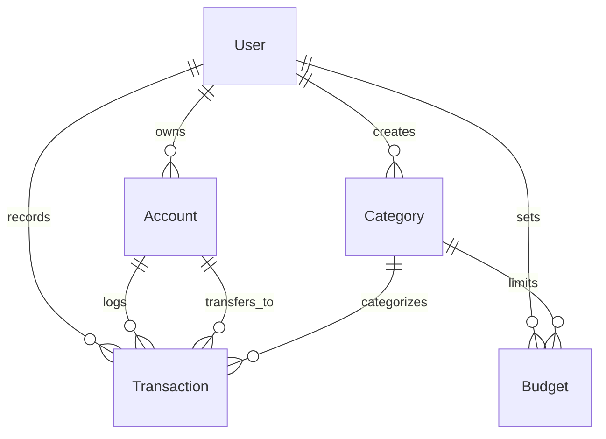

# Database Architecture & Mongoose Schema Reference (`docs/DB.md`)

This document defines the database schemas, relationships, indexing strategies, and lifecycle management for MongoDB Atlas in **Antigravity Finance Tracker**.

---

## 1. Entity-Relationship Overview

---

## 2. Collections & Schemas

### 2.1 `users`

Stores user profile information, authentication credentials, security codes, and global preferences.

| Field                       | Type          | Required    | Default     | Description / Constraints                                      |
| :-------------------------- | :------------ | :---------- | :---------- | :------------------------------------------------------------- |
| `_id`                       | `ObjectId`    | Yes         | Auto        | Unique identifier                                              |
| `name`                      | `String`      | Yes         | —           | Full name (max 100 chars, trimmed)                             |
| `email`                     | `String`      | Yes         | —           | Unique, lowercase, trimmed, indexed                            |
| `password`                  | `String`      | Conditional | —           | Bcrypt hash. Required unless `googleId` is provided            |
| `googleId`                  | `String`      | No          | `undefined` | Google OAuth unique subject id (sparse index)                  |
| `avatarUrl`                 | `String`      | No          | `''`        | User profile avatar image URL                                  |
| `isVerified`                | `Boolean`     | Yes         | `false`     | Email verification flag                                        |
| `verificationOtpHash`       | `String`      | No          | `null`      | SHA-256 hash of 6-digit verification code                      |
| `verificationOtpExpiresAt`  | `Date`        | No          | `null`      | Code expiration (15 minutes from issue)                        |
| `passwordResetOtpHash`      | `String`      | No          | `null`      | SHA-256 hash of password reset code                            |
| `passwordResetOtpExpiresAt` | `Date`        | No          | `null`      | Reset code expiration (15 minutes)                             |
| `resendCooldownUntil`       | `Date`        | No          | `null`      | 60-second cooldown timestamp for OTP resends                   |
| `refreshTokenHash`          | `String`      | No          | `null`      | SHA-256 hash of active refresh token for rotation / revocation |
| `defaultCurrency`           | `String`      | Yes         | `'USD'`     | User base currency (uppercase, e.g. `'USD'`, `'BDT'`, `'EUR'`) |
| `monthlyBudgetLimit`        | `Number`      | No          | `null`      | Overall monthly spending ceiling                               |
| `customExchangeRates`       | `Map<Number>` | No          | `{}`        | Key-value map of user custom currency exchange overrides       |
| `themePreference`           | `String`      | Yes         | `'system'`  | `'light' \| 'dark' \| 'system'`                                |
| `createdAt` / `updatedAt`   | `Date`        | Yes         | Auto        | Managed timestamps                                             |

**Indexes**:

- `{ email: 1 }` (unique)
- `{ googleId: 1 }` (sparse)
- `{ isVerified: 1 }`

---

### 2.2 `accounts`

Multi-currency wallets and accounts owned by users.

| Field                     | Type       | Required | Default     | Description / Constraints                                       |
| :------------------------ | :--------- | :------- | :---------- | :-------------------------------------------------------------- |
| `_id`                     | `ObjectId` | Yes      | Auto        | Unique identifier                                               |
| `userId`                  | `ObjectId` | Yes      | —           | Reference to `User`                                             |
| `name`                    | `String`   | Yes      | —           | Wallet name (e.g., `'City Bank'`, `'bKash'`, `'Cash'`)          |
| `type`                    | `String`   | Yes      | `'cash'`    | `'cash' \| 'bank' \| 'bkash' \| 'nagad' \| 'credit' \| 'other'` |
| `balance`                 | `Number`   | Yes      | `0`         | Current balance (reconciled atomically with transactions)       |
| `currency`                | `String`   | Yes      | `'USD'`     | 3-letter currency code (uppercase)                              |
| `color`                   | `String`   | Yes      | `'#10b981'` | Hex color accent for UI badges                                  |
| `icon`                    | `String`   | Yes      | `'Wallet'`  | Lucide icon identifier                                          |
| `isArchived`              | `Boolean`  | Yes      | `false`     | Soft-deletion flag                                              |
| `createdAt` / `updatedAt` | `Date`     | Yes      | Auto        | Managed timestamps                                              |

**Indexes**:

- `{ userId: 1, isArchived: 1 }` (Fast query for active user accounts)

---

### 2.3 `categories`

Income and expense transaction classifications.

| Field                     | Type       | Required | Default     | Description / Constraints                                   |
| :------------------------ | :--------- | :------- | :---------- | :---------------------------------------------------------- |
| `_id`                     | `ObjectId` | Yes      | Auto        | Unique identifier                                           |
| `userId`                  | `ObjectId` | No       | `null`      | `null` for system default seeds; User `ObjectId` for custom |
| `name`                    | `String`   | Yes      | —           | Category name (e.g. `'Food & Dining'`)                      |
| `type`                    | `String`   | Yes      | —           | `'income' \| 'expense'`                                     |
| `icon`                    | `String`   | Yes      | `'Tag'`     | Lucide icon name                                            |
| `color`                   | `String`   | Yes      | `'#64748b'` | Hex color code                                              |
| `isDefault`               | `Boolean`  | Yes      | `false`     | True for system seeded categories                           |
| `createdAt` / `updatedAt` | `Date`     | Yes      | Auto        | Managed timestamps                                          |

**Indexes**:

- `{ userId: 1, type: 1 }` (Fetches user categories + system categories)

---

### 2.4 `transactions`

Income, expense, and inter-account transfers.

| Field                     | Type       | Required | Default    | Description / Constraints                      |
| :------------------------ | :--------- | :------- | :--------- | :--------------------------------------------- |
| `_id`                     | `ObjectId` | Yes      | Auto       | Unique identifier                              |
| `userId`                  | `ObjectId` | Yes      | —          | Reference to `User`                            |
| `accountId`               | `ObjectId` | Yes      | —          | Source account reference                       |
| `type`                    | `String`   | Yes      | —          | `'income' \| 'expense' \| 'transfer'`          |
| `amount`                  | `Number`   | Yes      | —          | Amount in source account's currency (min 0.01) |
| `currency`                | `String`   | Yes      | —          | Source currency code (uppercase)               |
| `convertedAmount`         | `Number`   | Yes      | —          | Amount converted to user's `defaultCurrency`   |
| `destinationAccountId`    | `ObjectId` | No       | `null`     | Target account (transfers only)                |
| `destinationAmount`       | `Number`   | No       | `null`     | Amount credited to destination account         |
| `destinationCurrency`     | `String`   | No       | `null`     | Destination currency code                      |
| `categoryId`              | `ObjectId` | No       | `null`     | Reference to `Category`                        |
| `date`                    | `Date`     | Yes      | `Date.now` | Effective transaction date                     |
| `description`             | `String`   | Yes      | —          | Memo / description (max 255 chars)             |
| `vendor`                  | `String`   | No       | `''`       | Vendor name (from OCR or manual input)         |
| `receiptUrl`              | `String`   | No       | `''`       | Cloudinary or fallback receipt image URL       |
| `receiptOcrData`          | `Mixed`    | No       | `null`     | Structured OCR output JSON                     |
| `isDemo`                  | `Boolean`  | Yes      | `false`    | Flag for sample demo transactions              |
| `createdAt` / `updatedAt` | `Date`     | Yes      | Auto       | Managed timestamps                             |

**Indexes**:

- `{ userId: 1, date: -1 }` (Recent user transactions)
- `{ userId: 1, categoryId: 1, date: -1 }` (Category spending history)
- `{ userId: 1, accountId: 1, date: -1 }` (Account ledger history)

---

### 2.5 `budgets`

Monthly spending targets per category.

| Field                     | Type       | Required | Default | Description / Constraints  |
| :------------------------ | :--------- | :------- | :------ | :------------------------- |
| `_id`                     | `ObjectId` | Yes      | Auto    | Unique identifier          |
| `userId`                  | `ObjectId` | Yes      | —       | Reference to `User`        |
| `categoryId`              | `ObjectId` | Yes      | —       | Reference to `Category`    |
| `month`                   | `Number`   | Yes      | —       | Calendar month (1 to 12)   |
| `year`                    | `Number`   | Yes      | —       | Calendar year (e.g. 2026)  |
| `limitAmount`             | `Number`   | Yes      | —       | Maximum expenditure limit  |
| `currency`                | `String`   | Yes      | `'USD'` | Limit currency (uppercase) |
| `createdAt` / `updatedAt` | `Date`     | Yes      | Auto    | Managed timestamps         |

**Indexes**:

- `{ userId: 1, categoryId: 1, month: 1, year: 1 }` (Unique compound constraint)

---

### 2.6 `exchangerates`

24-hour cache for live currency conversion rates.

| Field          | Type          | Required | Default    | Description / Constraints   |
| :------------- | :------------ | :------- | :--------- | :-------------------------- |
| `_id`          | `ObjectId`    | Yes      | Auto       | Unique identifier           |
| `baseCurrency` | `String`      | Yes      | `'USD'`    | Base currency code (unique) |
| `rates`        | `Map<Number>` | Yes      | —          | Key-value exchange rates    |
| `fetchedAt`    | `Date`        | Yes      | `Date.now` | Retrieval timestamp         |
| `expiresAt`    | `Date`        | Yes      | —          | Expiration timestamp        |

**Indexes**:

- `{ baseCurrency: 1 }` (Unique)
- `{ expiresAt: 1 }` with `{ expires: 0 }` (MongoDB TTL index for automatic deletion)

---

## 3. Financial Integrity & Precision Rules

1. **2-Decimal Math**: All currency additions, subtractions, and balance modifications must pass through `roundCurrency(amount)` (`Math.round((val + Number.EPSILON) * 100) / 100`) in `server/src/utils/mathUtils.ts`.
2. **Atomic Balance Updates**:
   - Creating an `income` transaction increments the account balance.
   - Creating an `expense` transaction decrements the account balance.
   - Creating a `transfer` transaction atomically decrements the source account by `amount` and increments the destination account by `destinationAmount`.
   - Updating or deleting transactions must reverse the prior impact before applying the updated balance impact.
