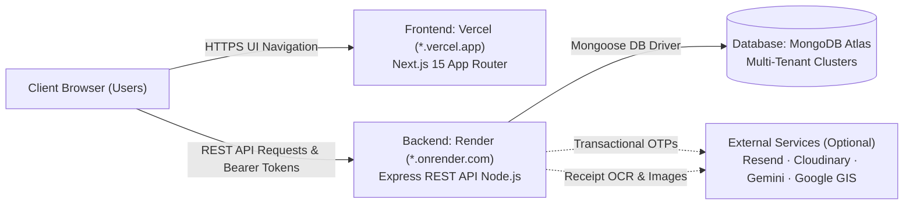

# Production Deployment Guide (`docs/DEPLOYMENT.md`)

This guide provides step-by-step instructions for deploying **Antigravity Finance Tracker** to production using **MongoDB Atlas** (Database), **Render** (Express REST API Backend), and **Vercel** (Next.js 15 Frontend).

---

## 1. Architecture & Deployment Boundaries



- **Client (`client/`)**: Deployed to **Vercel** as a standalone Next.js App Router application. All PDF and CSV statement generation is executed strictly client-side to minimize memory usage and preserve data privacy.
- **Server (`server/`)**: Deployed to **Render** as a Node.js Web Service on the free or starter tier (512MB RAM guardrails).
- **Database**: **MongoDB Atlas** M0 free or serverless cluster.

---

## 2. Step 1: MongoDB Atlas Database Setup

1. Sign in to [MongoDB Atlas](https://www.mongodb.com/cloud/atlas).
2. **Create a Cluster**:
   - Choose **M0 Free** (Shared) in your nearest region (e.g. AWS / Google Cloud).
   - Cluster Name: e.g. `antigravity-finance-cluster`.
3. **Configure Database User**:
   - Navigate to **Security** → **Database Access**.
   - Click **Add New Database User**.
   - Authentication Method: **Password**.
   - Set Username (e.g. `finance_admin`) and a strong auto-generated password (save this securely).
   - Built-in Role: **Read and write to any database**.
4. **Configure Network Access**:
   - Navigate to **Security** → **Network Access**.
   - Click **Add IP Address**.
   - Click **Allow Access from Anywhere** (`0.0.0.0/0`).
   - _Note: Render web services use dynamic IP pools, so access from anywhere is required._
5. **Get Connection String**:
   - Navigate to **Deployment** → **Database** → **Connect**.
   - Choose **Drivers** (Node.js).
   - Copy the connection URI:
     ```text
     mongodb+srv://<username>:<password>@antigravity-finance-cluster.xxxx.mongodb.net/finance_tracker?retryWrites=true&w=majority
     ```
   - Replace `<username>` and `<password>` with your created database credentials.

---

## 3. Step 2: Render Backend Web Service Setup

You can deploy the backend using either the **Render Blueprint (`render.yaml`)** or manual configuration.

### Option A: Turnkey Blueprint Deployment (Recommended)

1. Sign in to your [Render Dashboard](https://dashboard.render.com).
2. Click **New +** → **Blueprint**.
3. Connect your GitHub repository: `antigravity-finance-tracker`.
4. Render automatically detects the root [`render.yaml`](../render.yaml) file.
5. In the blueprint variables screen, provide:
   - `MONGODB_URI`: Your MongoDB Atlas connection string.
   - `CLIENT_URL`: `https://<your-vercel-app>.vercel.app` (or temporary `http://localhost:3000` until frontend is deployed).
   - (Optional API keys): `RESEND_API_KEY`, `GEMINI_API_KEY`, `CLOUDINARY_*`, `GOOGLE_CLIENT_ID`.
6. Click **Apply**. Render will generate crypto secrets for `JWT_ACCESS_SECRET` and `JWT_REFRESH_SECRET` and build the service.

### Option B: Manual Web Service Setup

1. In Render Dashboard, click **New +** → **Web Service**.
2. Connect your GitHub repository.
3. Configure the build and start settings:
   - **Name**: `antigravity-finance-server`
   - **Root Directory**: `server`
   - **Environment**: `Node`
   - **Region**: Same or nearest region to your MongoDB Atlas cluster
   - **Branch**: `main`
   - **Build Command**: `npm install && npm run build`
   - **Start Command**: `npm run start`
   - **Health Check Path**: `/api/health`
4. Add the following **Environment Variables** under the **Environment** tab:

| Variable Name            | Value / Description                                                                          | Required? |
| :----------------------- | :------------------------------------------------------------------------------------------- | :-------- |
| `NODE_ENV`               | `production`                                                                                 | Yes       |
| `PORT`                   | `10000`                                                                                      | Yes       |
| `CLIENT_URL`             | `https://<your-app>.vercel.app` (your production Vercel URL)                                 | Yes       |
| `MONGODB_URI`            | `mongodb+srv://<user>:<pwd>@cluster.mongodb.net/finance_tracker?retryWrites=true&w=majority` | Yes       |
| `JWT_ACCESS_SECRET`      | At least 32 characters (e.g. `openssl rand -hex 32`)                                         | Yes       |
| `JWT_REFRESH_SECRET`     | At least 32 characters (e.g. `openssl rand -hex 32`)                                         | Yes       |
| `JWT_ACCESS_EXPIRES_IN`  | `15m`                                                                                        | Yes       |
| `JWT_REFRESH_EXPIRES_IN` | `7d`                                                                                         | Yes       |
| `RESEND_API_KEY`         | `re_xxxx...` (omit to use terminal fallback)                                                 | Optional  |
| `GEMINI_API_KEY`         | Gemini 1.5 API Key (omit to use built-in mock OCR fallback)                                  | Optional  |
| `CLOUDINARY_CLOUD_NAME`  | Cloudinary cloud identifier                                                                  | Optional  |
| `CLOUDINARY_API_KEY`     | Cloudinary API Key                                                                           | Optional  |
| `CLOUDINARY_API_SECRET`  | Cloudinary API Secret                                                                        | Optional  |
| `GOOGLE_CLIENT_ID`       | Google Cloud OAuth Client ID                                                                 | Optional  |

5. Click **Create Web Service**.
6. When deployment finishes, copy your Render service URL (e.g., `https://antigravity-finance-server.onrender.com`).

---

## 4. Step 3: Vercel Frontend Deployment Setup

1. Sign in to your [Vercel Dashboard](https://vercel.com).
2. Click **Add New...** → **Project**.
3. Import your GitHub repository: `antigravity-finance-tracker`.
4. Configure the project:
   - **Framework Preset**: **Next.js**
   - **Root Directory**: Click **Edit** and select `client`
   - **Build and Output Settings**: Defaults (`npm run build`)
5. Configure **Environment Variables**:

| Variable Name                  | Value                                                       | Required? |
| :----------------------------- | :---------------------------------------------------------- | :-------- |
| `NEXT_PUBLIC_API_URL`          | `https://<your-render-service>.onrender.com/api`            | Yes       |
| `NEXT_PUBLIC_GOOGLE_CLIENT_ID` | Google OAuth Client ID (matching server `GOOGLE_CLIENT_ID`) | Optional  |

6. Click **Deploy**.
7. Once deployment finishes, Vercel gives you your production URL:
   `https://<project-name>.vercel.app`

---

## 5. Step 4: Finalize CORS Authorization

Once your Vercel URL is live:

1. Return to your **Render Dashboard** → `antigravity-finance-server` → **Environment**.
2. Update `CLIENT_URL` to your exact Vercel production origin:
   ```text
   CLIENT_URL=https://<your-project-name>.vercel.app
   ```
3. Save changes. Render will redeploy with updated CORS rules allowing the browser to send requests and auth headers.

---

## 6. Step 5: Optional Third-Party Services Setup

The application works out of the box with built-in fallbacks. Follow these steps when you are ready to configure live third-party services:

### 6.1 Resend (Transactional Email & OTPs)

1. Sign up at [Resend.com](https://resend.com).
2. Generate an API Key under **API Keys**.
3. Add a verified domain or use `onboarding@resend.dev` for initial testing.
4. Set `RESEND_API_KEY=re_xxxx` in Render environment variables.

### 6.2 Google Identity Services (Google GIS OAuth)

1. Go to [Google Cloud Console](https://console.cloud.google.com/).
2. Create a project and navigate to **APIs & Services** → **Credentials**.
3. Click **Create Credentials** → **OAuth client ID** (Web application).
4. Add Authorized JavaScript Origins:
   - `https://<your-project-name>.vercel.app`
   - `http://localhost:3000` (for local dev)
5. Copy the Client ID.
6. Set:
   - In Render: `GOOGLE_CLIENT_ID=<client-id>`
   - In Vercel: `NEXT_PUBLIC_GOOGLE_CLIENT_ID=<client-id>`

### 6.3 Cloudinary (Receipt Image Uploads)

1. Sign up at [Cloudinary.com](https://cloudinary.com).
2. From the Dashboard, copy **Cloud Name**, **API Key**, and **API Secret**.
3. Set `CLOUDINARY_CLOUD_NAME`, `CLOUDINARY_API_KEY`, and `CLOUDINARY_API_SECRET` in Render.

### 6.4 Google Gemini API (Receipt OCR)

1. Get a Gemini API key from [Google AI Studio](https://aistudio.google.com/).
2. Set `GEMINI_API_KEY` in Render.

---

## 7. Step 6: Post-Deployment Verification Checklist

After deploying, verify the live system using this checklist:

- [ ] **Heartbeat Probe**: Visit `https://<your-render-service>.onrender.com/api/health` and verify `{"status":"ok"}`.
- [ ] **Landing Page**: Visit `https://<your-app>.vercel.app/` and verify hero section, feature cards, and theme switcher.
- [ ] **Registration & OTP**: Create a new account with email/password; confirm email OTP verification succeeds and redirects to `/dashboard`.
- [ ] **Account Seeding**: Check that default categories and `Main Checking` account are automatically seeded upon first login.
- [ ] **Multi-Currency Wallets**: Add a secondary wallet in EUR or BDT; verify total net balance computes converted sum accurately.
- [ ] **Transactions & Balances**: Create an expense and a transfer; verify wallet balances adjust atomically.
- [ ] **Receipt OCR**: Upload a receipt image or mock file; verify scanning indicator and field population.
- [ ] **Monthly Budgets**: Set a category budget limit; record an expense to trigger `<80%` normal, `80-99%` warning, or `100%+` exceeded alert badge.
- [ ] **Visual Dashboard**: Verify AM/PM local clock greeting, Recharts Cash Flow bars, and category donut chart render without SSR hydration warnings.
- [ ] **Client-Side Exports**: Click **Export CSV** and **Export PDF** on `/transactions`; confirm download completes in-browser.
